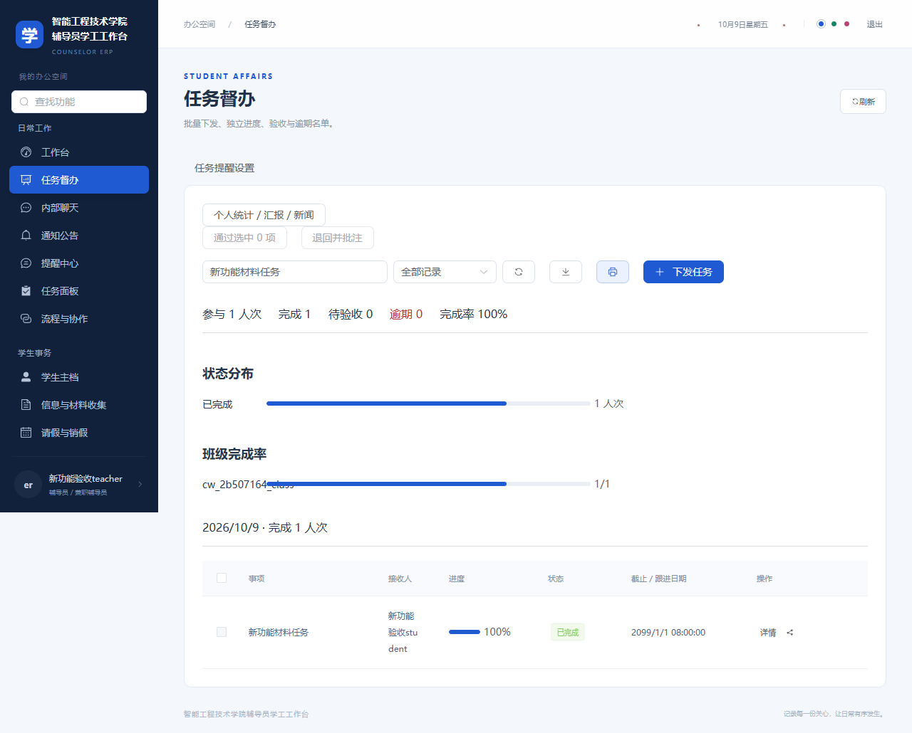
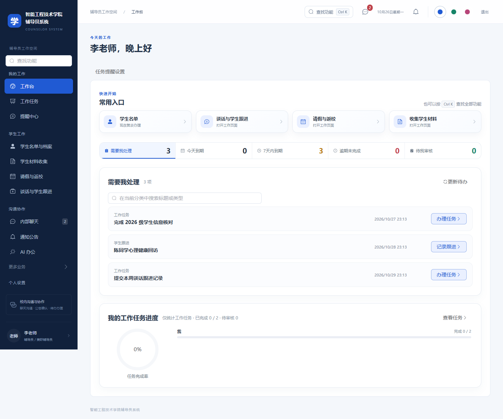
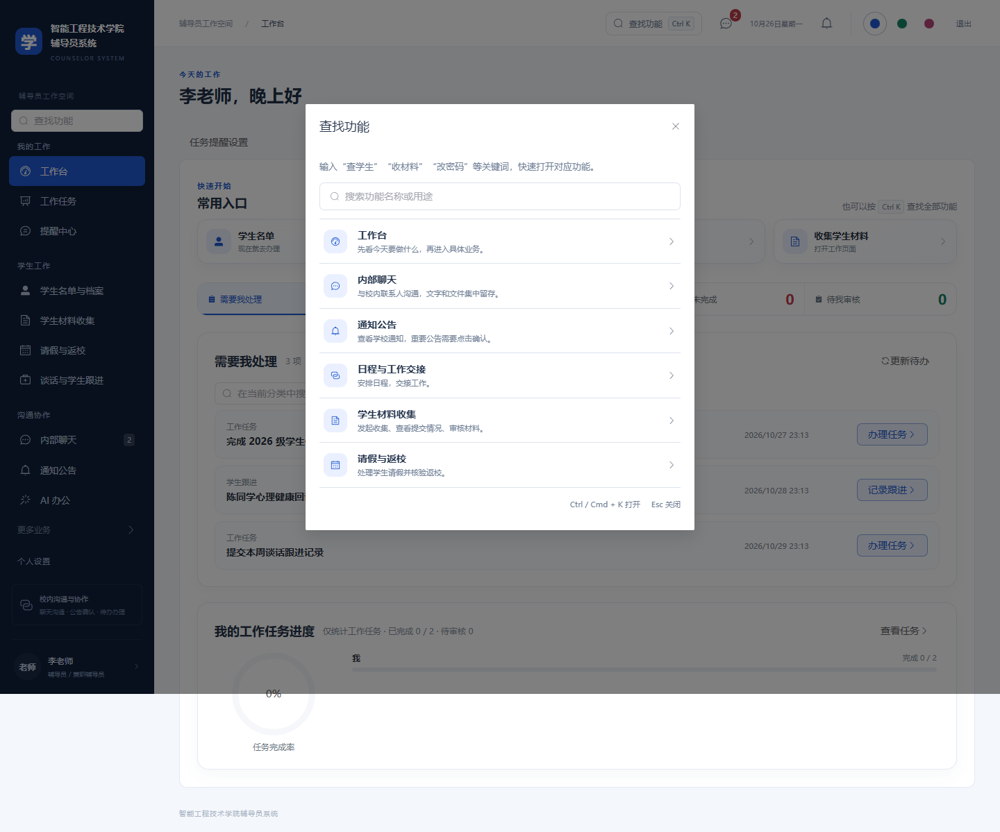
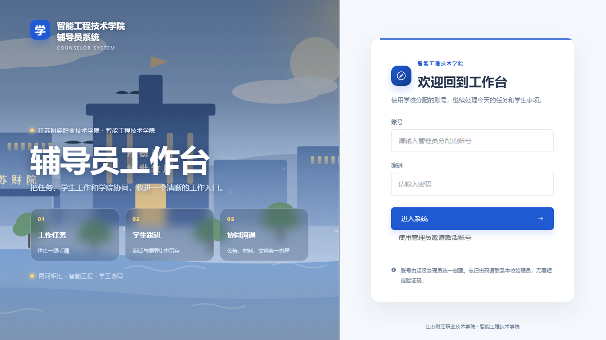
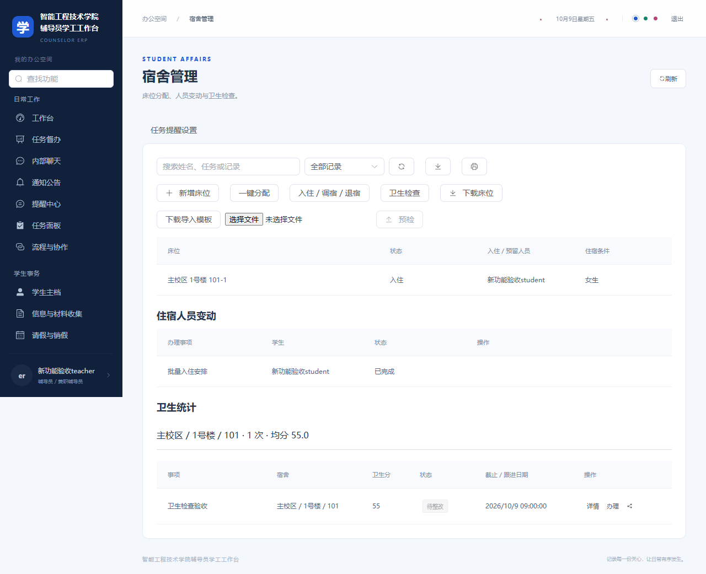
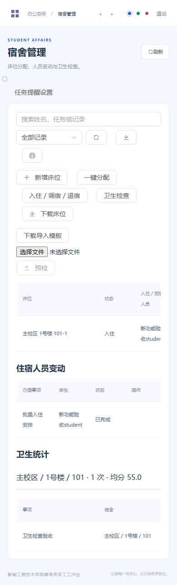
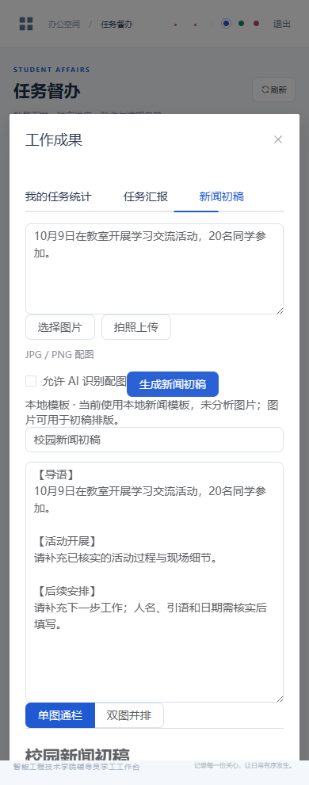

# Counselor Workflow System · 辅导员工作流系统

> A readable, sanitized case study of a role-based student-affairs workflow interface.
>
> 面向辅导员日常事务的角色化工作流展示项目，聚焦结构化记录、提醒、知识检索与跨端阅读体验。

[Open the online showcase](https://guhang2011.github.io/counselor-workflow-showcase/) · [View the profile](https://github.com/GuHang2011)

## v1.3.0 · 2026-11-01

业务资料与内部聊天补齐导入、导出和打印。任务与床位先检查再确认，学生名单按当前列表输出，宿舍床位、人员变动和卫生分别输出；聊天支持完整历史 TXT / CSV、日期筛选及打印，新增 UTF-8 TXT / CSV 文件收发。

- [使用说明](docs/data-io-v1.3.0.md) · [版本说明](docs/releases/v1.3.0.md)
- [22 份源码摘录与测试](examples/app-v1.3.0/README.md) · [5 张新截图](docs/screenshots-v1.3.0.md)
- [验收摘要](docs/evidence/v1.3.0.json)：147 项后端测试、37 项浏览器回归、15 项 HTTP 检查与 8 组浏览器专项检查通过。无需数据库结构迁移。

## v1.2.0 · 2026-11-01

内部聊天支持 12 张原创办公表情包和 24 个常用表情：选择后预览，点击发送；电脑和手机都能直接查看。失败保留草稿，重试避免重复，历史消息和会话摘要保留可读说明。

- [使用与权限说明](docs/chat-stickers-v1.2.0.md) · [版本说明](docs/releases/v1.2.0.md)
- [本版源码、测试及原创素材](examples/app-v1.2.0/README.md) · [4 张最新截图](docs/screenshots-v1.2.0.md)
- [验收摘要](docs/evidence/v1.2.0.json)：138 项后端测试、37 项浏览器回归、15 项 HTTP 检查、聊天与重启持久化通过，另完成 7 组交互专项检查。无数据库结构迁移。

## v1.1.3 · 2026-11-01

本版从辅导员日常操作出发，解决 8 类体验问题：手机任务卡片、筛选残留、紧急排序、断网重试、发布表单、汇报编辑保护、首页分类高亮以及长弹窗操作。

- [版本说明](docs/releases/v1.1.3.md) · [逐项问题与解决](docs/ux-review-20261031.md)
- [9 份源码与测试摘录](examples/app-v1.1.3/README.md) · [4 张最新截图](docs/screenshots-v1.1.3.md)
- [验收摘要](docs/evidence/v1.1.3.json)：15 项共享逻辑、37 项浏览器回归、15 项 HTTP 检查及聊天/重启持久化通过；另验证手机操作、汇报保护与弹窗可视范围。后端产物沿用 v1.1.2。

## v1.1.2 · 2026-10-31

本版逐项修复 7 类功能设计问题：提醒直达、消息状态措辞、手机全选审核、任务生效与截止时间、跟进日期、实时逾期以及统计失败重试。

- [版本说明](docs/releases/v1.1.2.md) · [问题与修复清单](docs/functional-review-20261031.md)
- [9 份本轮代码摘录](examples/app-v1.1.2/README.md) · [最新功能截图](docs/screenshots-v1.1.2.md)
- [脱敏验收摘要](docs/evidence/v1.1.2.json)：135 项后端、13 项共享逻辑、37 项浏览器回归通过；目标宝塔 MySQL 和真实服务环境仍需验证。

## v1.1.1 · 目录整理

公开摘录按辅导员工作流项目统一命名为 [frontend](examples/app-v1.1.0/frontend) 与 [backend](examples/app-v1.1.0/backend)，同步打包示例、测试夹具和源码校验清单。摘录仍来自 v1.1.0 的应用代码，完整业务系统的验收结论沿用原记录。[本次说明与迁移](docs/releases/v1.1.1.md)。

## v1.1.0 · 2026-10-30

本版整理清爽校园办公 UI、待办优先的工作台，以及会话隔离、断网退出、CSV 导出、登录限流、AI 配置与附件清理等 11 类修复。

- [版本总结](docs/releases/v1.1.0.md) · [更新日志](CHANGELOG.md) · [版本规则](docs/versioning.md)
- [安全问题与修复明细](docs/security-review-20261030.md) · [UI 与交互改版](docs/ui-review-20261030.md)
- [实际前后端代码摘录](examples/app-v1.1.0/README.md) · [6 张本轮截图](docs/screenshots-v1.1.0.md)
- [脱敏验收摘要](docs/evidence/v1.1.0.json)：132 项后端测试、32 项浏览器回归通过。

后续每次交付递增 VERSION，发布同名 Git 标签和版本说明。修复使用补丁号，新功能使用次版本号，不兼容变化使用主版本号。公开仓库继续提供展示和源码摘录；完整部署包在本地交付。目标 MySQL、HTTPS、病毒扫描与旧框架风险仍需处理，桌面依赖仍有 9 项包级告警。

## 2026-10-28：上线前优化记录

本轮整理了手机登录、工作台长标题、功能搜索、断网恢复、提醒偏好、AI 异常提示和图标体积优化。

- [逐项修复与验收说明](docs/prelaunch-review-20261028.md)：32 项浏览器回归、15 项 HTTP 检查和部署边界。
- [实际 Vue 代码摘录与接入补丁](examples/vue-prelaunch/README.md)：组件源码、样式、图标注册和 10 项新增专项测试。
- [最终脱敏验收摘要](docs/evidence/prelaunch-20261028.json)：前后端产物与浏览器报告的校验值。
- [在线查看最新截图](https://guhang2011.github.io/counselor-workflow-showcase/#prelaunch)：手机登录、桌面/手机首页及手机搜索。

这些验收针对完整的本地应用；公开仓库仍是静态展示和代码摘录，不能直接部署成业务系统。宝塔 MySQL、生产扫描和 HTTPS 尚需现场验证，旧依赖告警尚未全部解决。

## What this repository shows

This repository is a **portfolio selection**, prepared from a larger local Vue + Spring Boot application. It shows the parts that are useful for a reviewer to inspect quickly:

- role-aware navigation and task-oriented information architecture;
- explicit request states, ownership and handoff semantics;
- API contract examples that require endpoint-level server deduplication before retrying writes;
- a flat visual system for dense administrative interfaces;
- screenshot evidence from a clean test login screen and responsive task, dormitory and news layouts;
- a public-safe view of report generation, file review and account-state design.

It is intentionally small. The production-oriented repository, database, uploads, logs, deployment secrets and internal requirements are not included.

## 阅读路径

1. 先打开在线展示页，切换角色和模块，并放大查看登录页截图。
2. 阅读 [`src/workflow-state.ts`](src/workflow-state.ts)，了解前端如何表达待处理、转介、补正和办结状态。
3. 阅读 [`docs/architecture.md`](docs/architecture.md)，了解从界面到服务端的责任边界。
4. 查看 [`docs/reading-notes.md`](docs/reading-notes.md)，延伸到前端状态、数据质量、可访问性和弱网重试。

## Scope and privacy

- Screenshots show blank login screens or isolated synthetic workflows. Test account names such as `erp_test_*` are generated fixtures; no real student records or entered credentials are included.
- Task labels, counters and identifiers in the static showcase are synthetic.
- No real student name, student number, phone number, email address, attachment, database, token, password or private deployment setting is published here.
- The code is a curated teaching and portfolio sample; it is not a complete deployable copy of the original system.

## Recent interface evidence

These screenshots come from isolated test data and contain no real student records or credentials.

| Screen | Desktop | Mobile |
| --- | --- | --- |
| Task dashboard and progress |  | — |
| Counselor dashboard shortcuts |  | — |
| Feature search command palette |  | — |
| Smart Engineering Technology College login |  | — |
| Dormitory allocation and hygiene |  |  |
| AI-assisted news draft layout | — |  |

The underlying application now supports personal task statistics, text and editable PPT reports, optional AI news drafting with image layout, multi-review with rejection comments, administrator time extensions, file-required tasks, account states with forced initial password changes, role-aware shortcuts and function search. The public showcase remains static and deliberately excludes those production credentials and data paths. See [`docs/ui-refresh-20261026.md`](docs/ui-refresh-20261026.md) for the previous refresh, and [`docs/prelaunch-review-20261028.md`](docs/prelaunch-review-20261028.md) for that historical snapshot. Current release evidence is in [`docs/releases/v1.3.0.md`](docs/releases/v1.3.0.md).

## Run the static showcase locally

With Python 3 installed, run this from the repository root:

```sh
python -m http.server 8080 --bind 127.0.0.1
```

Open <http://127.0.0.1:8080/>. The page uses plain HTML, CSS and JavaScript. No login, database, build step or backend is required. Role and module buttons change example text; they do not enforce authorization or submit real requests.

The two standalone TypeScript files in root `src/` are domain/API teaching examples, not a backend or a connected part of the page. The new `examples/vue-prelaunch/` contains actual Vue application extracts and integration patches; its browser tests require the full private application and isolated fixtures. Run the contract checks with Node.js 22.18+ (or Node.js 24+):

```sh
node --test tests/contracts.test.mjs
```

## Original application context

The larger local application uses Vue, TypeScript and Spring Boot. This public repository contains a **new static presentation and small illustrative extracts**, not the full application or its dependencies. The login screenshots document the source interface only; they do not demonstrate deployment, load capacity or user impact.

## Evidence

| Evidence | What to inspect |
| --- | --- |
| Online showcase | Role switcher, module selector, screenshot lightbox and `Ctrl/Cmd + K` feature search |
| Workflow model | State transitions, owner-only actions, explicit transfer target and version checks in `src/workflow-state.ts` |
| Retry contract | A stable key plus explicit endpoint deduplication support in `src/api-contract.ts` |
| Contract checks | Transfer, ownership, conflict and retry failure cases in `tests/contracts.test.mjs` |
| Architecture note | UI, API, domain and audit boundaries in `docs/architecture.md` |
| Screenshots | Login, counselor dashboard, feature search, task, dormitory and news states in `assets/` |

## Attribution boundary

The showcase describes engineering practice and interface design. It does not claim ownership of institutional data or disclose confidential implementation details.
