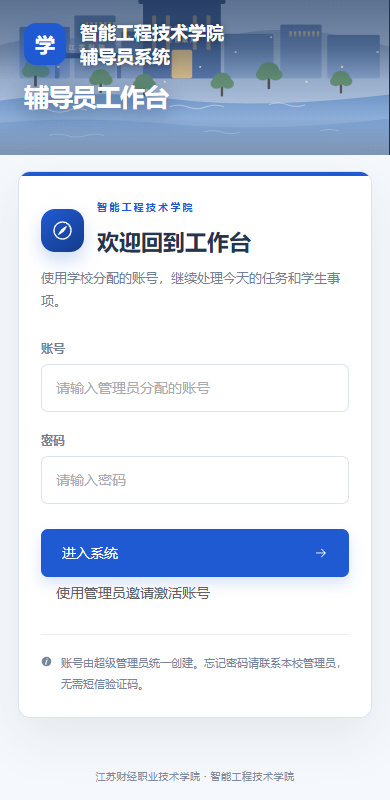
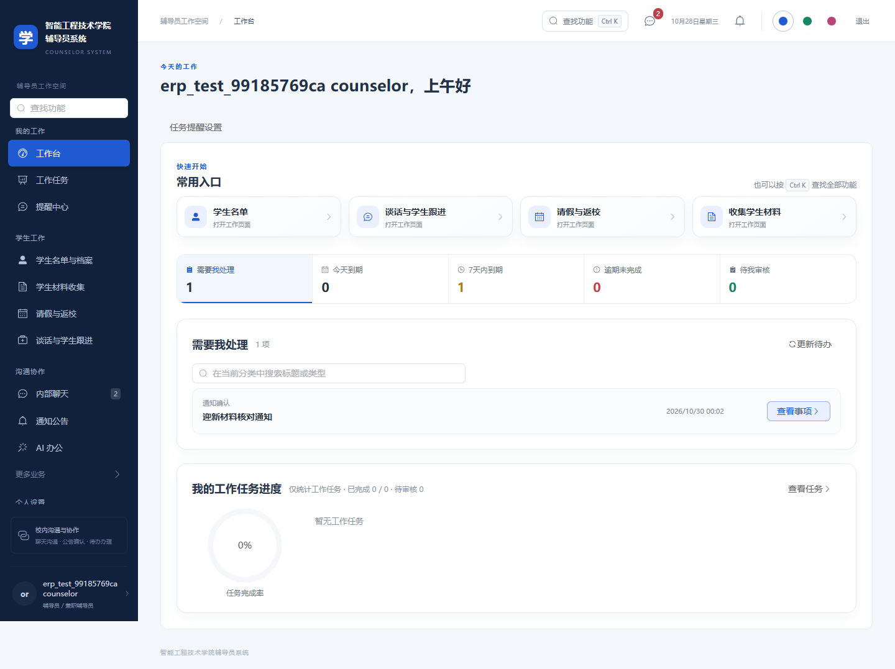
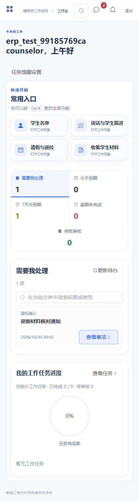
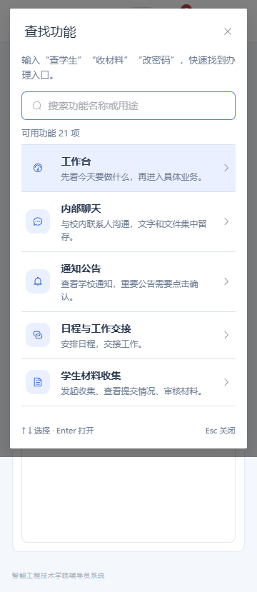

# 上线前前端优化与验收 · 2026-10-28

本轮围绕“辅导员能直接找到入口、看清待办、遇到网络问题知道怎样继续”整理登录、工作台、搜索、提醒和 AI 办公。审阅从 10 月 27 日开始，最终隔离验收于北京时间 10 月 28 日 00:04 完成。

## 问题与处理

| 问题 | 修改后的行为 | 代码与证据 |
| --- | --- | --- |
| 手机登录介绍区过长，登录按钮不在首屏 | 压缩小屏介绍，保留学院识别和账号/密码表单 | `prelaunch.css`；360/390/600px 登录首屏检查 |
| 断网刷新被迫重新登录 | 网络失败保留有效令牌，显示“重新连接”；明确 401 仍清理身份 | `integration.patch`；断开 `/auth/me` 后原地重试 |
| 搜索默认只显示前 12 项且键盘操作不完整 | 全部授权结果、上下选择、Enter 进入、Esc 关闭，兼容中文输入法 | `FeatureSearch.vue`；关键词、权限、空结果及小屏弹窗检查 |
| 快捷卡长标题截断、分类文字拥挤 | 允许标题换行，调整小屏间距和按钮尺寸 | `integration.patch`；360/390/768/1440px 检查 |
| 打印保留导航栏空白 | 主内容占满打印区域，隐藏操作按钮和筛选 | `prelaunch.css` 与工作台样式补丁；打印媒体检查 |
| 提醒设置读取失败仍能保存默认值 | 读取失败时隐藏表单、禁用保存、提供重新读取，成功后恢复原偏好 | `TaskReminder.vue`；真实保存 50 分钟/提前 12 小时偏好再模拟读取失败 |
| 多条提醒只有第一项可进入 | 每项显示独立查看按钮，进入对应业务模块 | `TaskReminder.vue` |
| AI 状态失败一直显示正在读取，写作/润色断线误显示制度问答 | 状态可重试；写作显示框架，润色明确保留未优化原文 | `AiWorkbench.vue`；注入网络失败检查 |
| 全量注册图标增加首屏脚本 | 293 个图标改为显式注册实际使用的 46 个 | `icons.ts`；主 JS 约 1,086.78 → 955.64 KB，gzip 345.33 → 311.31 KB |
| 缺少 favicon | 增加学院蓝毕业帽 SVG | `public/favicon.svg` |
| 预发布目录残留旧 hash 资源 | 清理专用构建目录后重建，重新完成全套验收再打包 | 最终 web 目录只有 31 个当前版本资源文件 |

首页任务服务失败时的“统计暂未加载”和重试入口也已回归验证，失败期间不显示虚假百分比；这一状态属于已有行为的验证。

所有代码摘录及接入补丁在 [examples/vue-prelaunch](../examples/vue-prelaunch/README.md)。没有把本地部署 JAR、数据库或附件打包进入公开仓库。

## 最终验证

| 检查 | 结果 |
| --- | --- |
| Vue 类型检查与生产构建 | 通过 |
| 请求客户端回归 | 6 项通过 |
| 隔离 HTTP 业务流程 | 15 项通过 |
| 聊天 HTTP 专项 | 通过 |
| Edge 浏览器业务与布局 | 32 项通过，0 失败、0 跳过、0 不稳定重试 |
| 后端重启后的数据、主题和聊天附件 | 通过 |
| 发布包脚本 / 部署脚本检查 | 18 / 10 项通过 |

浏览器范围包括管理员、辅导员、学生授权页面、聊天与文件、公告确认、材料审核、任务统计、PPT 下载、宿舍、谈话与团党记录、手机 H5、功能搜索和断网恢复。新增专项为 10 项；其余 22 项是原有回归。角色页面遍历是页面加载、接口错误和横向布局检查，不代表穷举所有业务分支。

[脱敏验收摘要](evidence/prelaunch-20261028.json) 保存最终产物和报告 hash。测试使用本机独立 H2、随机账号和临时附件；AI 检查使用本地模板和模拟断网。附件验收没有接入生产 ClamAV，不能据此声称病毒扫描通过。后端 JAR 复用此前构建，本轮没有重跑全部后端单元测试。

## 界面截图

图片直接来自隔离验收，`erp_test_*` 是临时合成账号，任务和日期均为测试内容；未输入真实账号密码。

| 界面 | 截图 |
| --- | --- |
| 手机登录 |  |
| 桌面工作台 |  |
| 手机工作台 |  |
| 手机功能搜索 |  |

## 上线边界

本地功能验收不等于正式上线批准。目标宝塔 Linux 主机仍需确认 MySQL 启动、HTTPS 和 `/api/` 反代、附件扫描、密钥与备份、真实文件上传下载和服务重启。此前反馈的宝塔 MySQL 服务启动失败未在本轮远程解决。

官方 npm 审计的当次结果：生产依赖图 16 项包级告警（14 high、2 moderate、0 critical），包含开发依赖的完整图 25 项（20 high、5 moderate）。统计含传递依赖传播，不是 16/25 个独立漏洞。旧 Vue 服务端渲染器、Element Plus、Lodash、PptxGenJS/image-size 和构建链仍需升级/可达性复核；本轮没有修改依赖锁文件，也未完成生产安全审计。当前应用是静态 SPA，不使用 SSR、`el-link` 或 `v-html`，但这些事实不能替代漏洞处置。正式开放前需要处理或明确评估这些告警。

本地候选包版本为 `20261028-prelaunch`，ZIP SHA256 为 `7b8d5e9708c3b2c36acba57ead7bfd1b45b152d26a8f59a4bcb966f2d52a1107`。候选包只在本地交付，此次 GitHub 更新提供说明、代码摘录、截图和脱敏证据，不发布完整部署程序。
