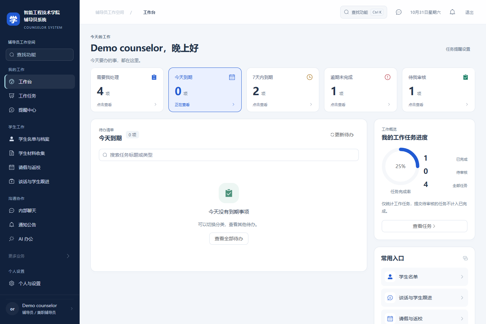
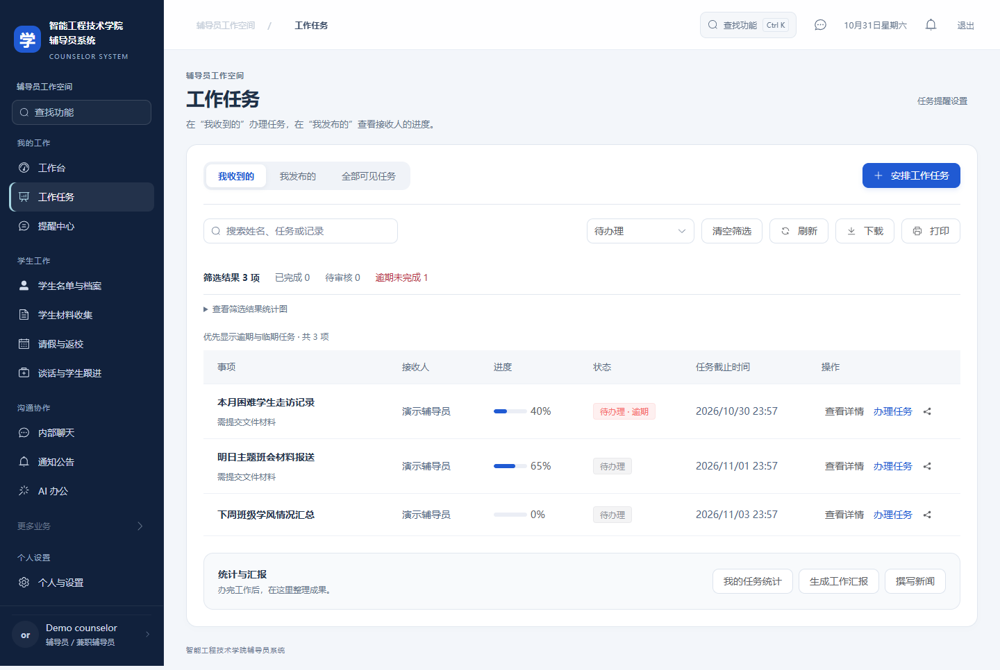
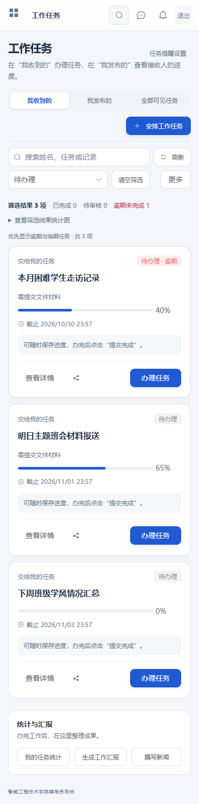
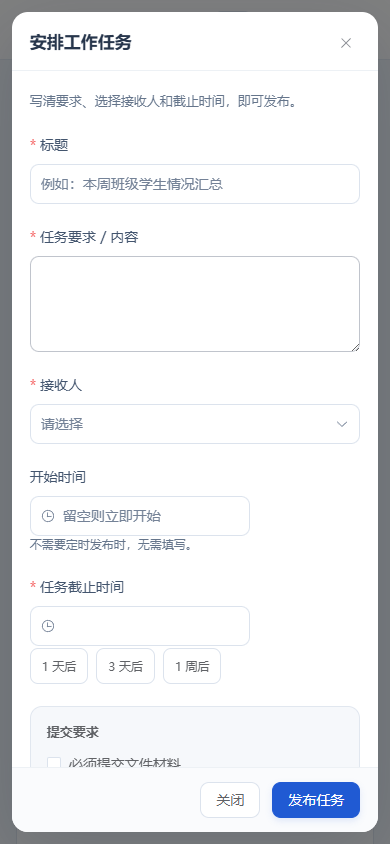

# v1.1.3 用户体验优化截图

截图摄于 2026-10-31 至 11-01，使用隔离预览账号和合成任务数据。无真实学生业务资料。页面保留原始渲染效果；截图中部分日期、已完成比例与任务仅用于说明排序、状态和响应式布局。首页展示切换到“今天到期”后的空状态，其他类别仍可查看。

## 桌面工作台与分类选中效果

## 桌面任务列表与办理入口

## 手机任务卡片与更多操作

## 手机发布任务表单

